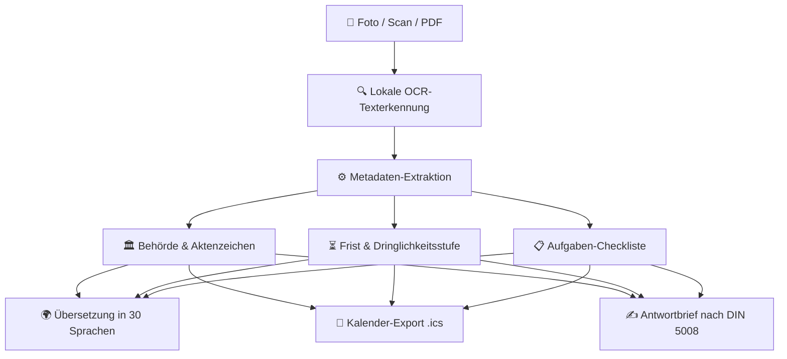

# 🏛️ AmtFlow (BriefHelfer)

[](https://opensource.org/licenses/MIT)
[](https://www.typescriptlang.org/)
[](https://github.com/KELLERBABG/AmtFlow)
[](https://github.com/KELLERBABG/AmtFlow#unterst%C3%BCtzte-sprachen-30)
[](https://github.com/KELLERBABG/AmtFlow)

> **Kostenloser, quelloffener und datenschutzfreundlicher Assistent für deutsche Behördenbriefe.**  
> Erkennt Fristen, Aktenzeichen und Handlungsaufforderungen direkt auf dem Gerät, übersetzt Behördendeutsch in Einfache Sprache (sowie 30 weitere Sprachen) und erstellt rechtssichere Antwortschreiben per Knopfdruck.

---

## 🎯 Überblick & Problemstellung

Über **40 % der Bürgerinnen, Bürger, Zugewanderten und Geflüchteten in Deutschland** haben erhebliche Schwierigkeiten, amtliche Bescheide und behördliche Schreiben (*Beamtendeutsch*) zu verstehen. Versäumte Rückmeldefristen bei Jobcentern, Finanzämtern oder Ausländerbehörden führen häufig zu existenzbedrohenden Leistungskürzungen oder rechtlichen Nachteilen.

**AmtFlow** ist ein gemeinnütziges Open-Source-Projekt (*Public Good*):

* 📷 **Lokale Texterkennung (OCR)**: Foto vom Brief machen oder PDF laden – die Erkennung läuft vollständig im Browser bzw. auf dem Smartphone.
* 🔍 **Automatische Extraktion**: Erkennt Absender-Behörde, Aktenzeichen, Datum und gesetzliche Fristen.
* ⏳ **Fristenrechner & Kalendereintrag**: Berechnet die verbleibenden Tage und exportiert eine `.ics`-Erinnerung direkt in den Handy-Kalender.
* ✍️ **Rechtssichere Antwortbriefe (DIN 5008)**: Generiert fertige Vorlagen für *Fristverlängerung*, *Widerspruch* oder *Nachreichung von Unterlagen*.
* 🌍 **30 Sprachen & Leichte Sprache**: Erklärt verständlich, worum es im Brief geht – inklusive Dari, Paschtu, Kurdisch Sorani, Arabisch, Tigrinya, Ukrainisch und Amharisch.
* 🔒 **100 % Privatsphäre**: Keine Registrierung, keine Cloud-Übertragung, kein Tracking.

---

## 🔄 Funktionsablauf



---

## 🚀 Schnellstart

### 1. Installation

```bash
git clone https://github.com/KELLERBABG/AmtFlow.git
cd AmtFlow
npm install
npm run build
```

### 2. Tests ausführen

```bash
npm test
```

---

## 💻 Anwendungsbeispiele

### 1. Behördenbrief analysieren & Frist berechnen

```typescript
import { extractLetterMetadata, generateCalendarIcs } from 'amtflow';

const briefText = `
Jobcenter Berlin Mitte
Aktenzeichen: BG-98213-4412
Datum: 18.08.2026

Aufforderung zur Mitwirkung:
Bitte reichen Sie Ihre Mietbescheinigung bis zum 08.09.2026 ein.
`;

// Extrahiert alle relevanten Daten
const ergebnis = extractLetterMetadata(briefText);

console.log(ergebnis.senderAgency);   // "Jobcenter"
console.log(ergebnis.aktenzeichen);   // "BG-98213-4412"
console.log(ergebnis.deadlineDate);   // "08.09.2026"
console.log(ergebnis.urgencyLevel);   // "HIGH"
console.log(ergebnis.actionChecklist); // ["Mietbescheinigung vom Vermieter einreichen"]

// .ics Kalenderdatei für Google / Apple Kalender generieren
const icsDatei = generateCalendarIcs(ergebnis);
```

### 2. Fristverlängerung generieren (DIN 5008)

```typescript
import { generateFormalReply } from 'amtflow';

const antwortBrief = generateFormalReply({
  templateType: 'FRISTVERLAENGERUNG',
  metadata: ergebnis,
  senderName: 'Max Mustermann',
  senderAddress: 'Musterstraße 12, 10115 Berlin',
  customReason: 'Krankheit und noch ausstehende Unterlagen des Vermieters'
});

console.log(antwortBrief);
```

---

## 🏛️ Unterstützte Behörden & Dokumenttypen

| Behörde / Stelle | Erkannte Dokumentarten |
|---|---|
| **Jobcenter / Agentur für Arbeit** | Mitwirkungsaufforderung, Weiterbewilligungsantrag (WBA), Sanktionsanhörung |
| **Finanzamt** | Steuererinnerung, Festsetzungsbescheid, Nachforderungsbescheid |
| **Ausländerbehörde / LEA** | Anhörung vor Ablehnung, Aufforderung zur Pass-/Einkommensvorlage |
| **Bürgeramt / Stadtverwaltung** | Meldeaufforderung, Gebührenbescheid, Passabholung |
| **Krankenkassen (AOK, TK, etc.)** | Fragebogen zur Familienversicherung, Einkommensnachweis |
| **Amtsgerichte** | Mahnbescheid, Zeugenvorladung, Fristsetzung |

---

## 🌐 Unterstützte Sprachen (30)

| Sprache | ISO-Code | Lokalisierter Name |
|---|---|---|
| **Deutsch (Leichte Sprache)** | `de` | Deutsch (Leichte Sprache) |
| **Englisch** | `en` | English |
| **Arabisch** | `ar` | العربية |
| **Dari** | `prs` | دری |
| **Paschtu** | `ps` | پښتو |
| **Türkisch** | `tr` | Türkçe |
| **Kurdisch (Kurmandschi)** | `ku` | Kurdî (Kurmancî) |
| **Kurdisch (Sorani)** | `ckb` | کوردی سۆرانی |
| **Ukrainisch** | `uk` | Українська |
| **Russisch** | `ru` | Русский |
| **Farsi / Persisch** | `fa` | فارسی |
| **Urdu** | `ur` | اردو |
| **Tigrinya** | `ti` | ትግርኛ |
| **Amharisch** | `am` | አማርኛ |
| **Somali** | `so` | Soomaali |
| **Französisch** | `fr` | Français |
| **Spanisch** | `es` | Español |
| **Polnisch** | `pl` | Polski |
| **Rumänisch** | `ro` | Română |
| **Bulgarisch** | `bg` | Български |
| **Albanisch** | `sq` | Shqip |
| **Bosnisch / Kroatisch / Serbisch** | `bs` | Bosanski / Hrvatski / Srpski |
| **Georgisch** | `ka` | ქართული |
| **Hindi** | `hi` | हिन्दी |
| **Vietnamesisch** | `vi` | Tiếng Việt |
| **Italienisch** | `it` | Italiano |
| **Portugiesisch** | `pt` | Português |
| **Ungarisch** | `hu` | Magyar |
| **Griechisch** | `el` | Ελληνικά |
| **Chinesisch (Mandarin)** | `zh` | 中文 |

---

## 🔒 Datenschutz & Offline-Sicherheit

* **100 % Lokale Verarbeitung**: Texterkennung (OCR) und Analyse laufen ausschließlich im lokalen Speicher des Browsers bzw. Smartphones.
* **Kein Server-Upload**: Es werden zu keinem Zeitpunkt Dokumente oder personenbezogene Daten an externe Server übertragen.
* **Keine Benutzerkonten & Kein Tracking**: Keine Cookies, keine Analytics, keine Drittanbieter-Tracker.

---

## 🤝 Mitwirken & Beitragen

Beiträge aus der Community sind herzlich willkommen:

1. Repository forken
2. Neuen Feature-Branch anlegen (`git checkout -b feature/NeueBehoerde`)
3. Änderungen committen (`git commit -m 'feat: Parser für Krankenkassen-Schreiben ergänzt'`)
4. Branch pushen (`git push origin feature/NeueBehoerde`)
5. Pull Request eröffnen

---

## 📄 Lizenz

Dieses Projekt ist unter der **MIT-Lizenz** lizenziert. Weitere Informationen in der Datei [`LICENSE`](LICENSE).