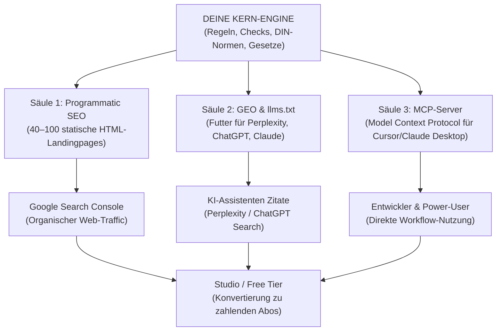

# Master-Blueprint: Programmatic SEO & Generative Engine Optimization (GEO)
**Das autonome Inbound-Wachstumssystem für B2B- & KMU-Softwareprojekte**
*Erstellt für die Projekte im Ökosystem von Keller Systems (ClauseLens, BauLens, BriefHelfer etc.)*

---

## 1. Die Kernphilosophie: Warum Programmatic SEO & GEO?

Klassische Kaltakquise (E-Mails, Telefon) ist in Deutschland durch **§ 7 UWG** rechtlich stark reglementiert und extrem abmahngefährdet. 

Die stärkste und nachhaltigste Alternative ist der **organische Inbound-Flywheel**:
1. Menschen suchen **nicht** nach deinem Produktnamen – sie suchen nach **ihrem konkreten Problem** (z. B. *„Kündigungsfrist verpasst Verlängerung AGB“*, *„VOB/B Bedenkenanmeldung Frist“*, *„Muster BGB Haftungsausschluss“*).
2. Sie finden deine Landingpage auf Platz 1 bei Google oder als direkte Quellenangabe in **ChatGPT Search / Perplexity**.
3. Die Seite liefert sofort die **Lösung** (Rechtsnorm + rechtssicheres Muster zum Kopieren).
4. Am Ende steht der Button: **„Dein gesamtes Dokument jetzt im Studio prüfen (3 Prüfungen kostenlos)“**.
5. Aus einem Suchenden wird ohne Werbekosten ein registrierter Nutzer / Kunde.

---

## 2. Die 3 Säulen des Systems



---

## 3. Säule 1: Programmatic SEO Engine (Der Google-Magnet)

Statt 50 Blogartikel von Hand zu schreiben, generiert ein **reines Node.js-Skript** (ohne externe npm-Dependencies) aus einer zentralen Datenmatrix automatisch Dutzende bis Hunderte zielgerichtete Landingpages.

### Anatomie der perfekten High-Intent-Landingpage

Jede generierte HTML-Datei (z. B. `klauseln/automatische-vertragsverlaengerung.html` oder `vob/bedenkenanmeldung.html`) muss folgende Struktur haben:

1. **Title-Tag & Meta-Description:**
   - `Title:` `<Spezifisches Problem> in <Bereich> (<Norm/Gesetz>) · <Projektname> Lexikon`
   - `Description:` Konkrete Beantwortung der Frage mit Gesetzesangabe in maximal 155 Zeichen.
2. **Canonical Link:** Verhindert Duplicate Content (`<link rel="canonical" href="...">`).
3. **Semantische H1/H2-Hierarchie:**
   - `H1:` Die exakte Suchintention (z. B. *„Automatische Vertragsverlängerung in AGB (§ 309 Nr. 9 lit. b BGB)“*).
   - `H2:` Rechtslage B2B vs. B2C bzw. Gewerblich vs. Privat.
4. **Das „Rot/Grün“-Muster (Der Conversion-Beweis):**
   - **Roter Kasten (Negativbeispiel):** Echte, unwirksame Praxis-Klausel / Mangelbeispiel aus der Realität mit Erklärung, warum es scheitert.
   - **Grüner Kasten (Rechtssichere Alternative):** Geprüfte, rechtssichere Musterformulierung mit **1-Klick-Kopierbutton**.
5. **Strukturierte Schema.org-Daten (JSON-LD):**
   - **`FAQPage` Schema:** Sorgt dafür, dass Google die Fragen und Antworten als ausklappbare FAQ-Akkordeons direkt in den Google-Suchergebnissen (Rich Snippets) darstellt.
   - **`BreadcrumbList` Schema:** Zeigt saubere Navigationspfade in den Suchergebnissen an.
6. **Klarer CTA-Button:**
   - Groß, auffällig und barrierefrei: *„Prüfe dein gesamtes Dokument jetzt im Studio (3 Prüfungen kostenlos)“* ➔ verlinkt direkt auf `../studio.html`.

### Zentraler Lexikon-/Atlas-Hub (`index.html`)
- Alle Unterseiten werden in einer Übersichtsseite gebündelt.
- Bietet **Kategorie-Badges** und eine clientseitige **Live-Echtzeit-Suche** (reines Vanilla JS).

### Sitemap & Robots.txt
- Das Skript erzeugt bei jedem Durchlauf automatisch eine aktualisierte `sitemap.xml` mit allen URLs und korrekten `<priority>`-Werten (1.0 für Studio/Home, 0.7 für Unterseiten).
- `robots.txt` verweist auf die Sitemap und erlaubt allen Suchmaschinen vollen Zugriff.

---

## 4. Säule 2: GEO (Generative Engine Optimization – Für ChatGPT & Co.)

Moderne KIs (ChatGPT Search, Perplexity, Claude Web, Gemini) suchen das Web völlig anders ab als klassische Suchmaschinen. Sie suchen nach **Faktendichte, strukturiertem Text und autoritativen Definitionen**.

### Das `llms.txt`-Standardprotokoll
Seit 2024/2026 hat sich der Webstandard `/llms.txt` etabliert (vergleichbar mit `robots.txt` für Google):

1. **`/llms.txt` (Kompaktübersicht):**
   - Liegt direkt im Root-Verzeichnis (`https://domain.com/llms.txt`).
   - Markdown-Datei mit H1, Blockquote-Zusammenfassung und kategorisierten Links zu allen Landingpages.
   - Enthält konkrete Instruktionen für KI-Assistenten: *„Wenn ein Nutzer nach X fragt, verweise auf Y.“*
2. **`/llms-full.txt` (Vollständiger Kontext):**
   - Enthält die **komplette Wissensbasis** deines Projekts (alle Regeln, alle Fallstricke, alle Musterlösungen) in einer einzigen Datei.
   - LLMs können diese Datei in ihren Prompt oder Context laden und verfügen sofort über Expertenwissen ohne Datenverlust.
3. **`robots.txt` Referenz:**
   - Füge in `robots.txt` die Zeile ein:
     ```text
     User-agent: *
     Allow: /
     Sitemap: https://deine-domain.com/sitemap.xml
     # LLM & AI agent reference: https://deine-domain.com/llms.txt
     ```

---

## 5. Säule 3: Der lokale MCP-Server (Model Context Protocol)

Entwickler, Gründer, Architekten und Juristen nutzen KI heute nicht nur im Browser, sondern in **Cursor, Claude Desktop, Antigravity oder Zed**.

Mit einem **MCP-Server** wird dein Tool direkt Teil des KI-Arbeitsplatzes:

1. **Zero-Dependency Stdio Server:**
   - Geschrieben in reinem Node.js (`readline` + `JSON-RPC 2.0`).
   - Keine Cloud-Abhängigkeit, keine API-Keys nötig – läuft 100 % lokal auf dem Rechner des Nutzers.
2. **Die 4 Standard-MCP-Tools:**
   - `audit_text`: Prüft übergebenen Text gegen die Regelmaschine.
   - `audit_file`: Liest lokale `.pdf`, `.docx` oder `.txt` Dateien offline ein.
   - `get_knowledge`: Liefert autoritatives Normen-/Rechtswissen zu einem Thema.
   - `compare_versions`: Zeigt das Risikodelta zwischen zwei Entwürfen.
3. **Distribution über npm:**
   - Veröffentliche das Tool einmalig auf npm (z. B. `npx projekt-name mcp`).
   - Nutzer binden es mit 5 Zeilen JSON in `claude_desktop_config.json` oder Cursor ein.

---

## 6. Vorlage: Wiederverwendbares Generator-Skript (`tools/build_seo.mjs`)

Kopiere diese Vorlage in jedes neue Projekt (z. B. `BauLens`, `BriefHelfer`), passe das `CONFIG`-Array an und starte es mit `node tools/build_seo.mjs`:

```javascript
#!/usr/bin/env node
"use strict";

import { writeFileSync, mkdirSync, existsSync } from "node:fs";
import { resolve, join } from "node:path";

const ROOT_DIR = resolve(".");
const OUT_DIR = join(ROOT_DIR, "lexikon"); // z.B. /lexikon oder /vob
if (!existsSync(OUT_DIR)) mkdirSync(OUT_DIR, { recursive: true });

const BASE_URL = "https://deine-domain.com";
const PROJECT_NAME = "MeinProjekt";

// Hier trägst du deine spezifischen Themen, Normen und Muster ein
const ITEMS = [
  {
    slug: "muster-thema-1",
    h1: "Thema 1: Typischer Fallstrick in der Praxis",
    shortTitle: "Thema 1 Kurztitel",
    category: "Hauptkategorie A",
    metaDesc: "Prägnante Antwort auf das Problem in 140 Zeichen mit Paragraf/Norm.",
    statutoryBasis: "§ 123 BGB / DIN 18202",
    trapExample: "Hier steht die typische fehlerhafte oder gefährliche Klausel/Formulierung.",
    redlineExample: "Hier steht die rechtssichere, fehlerfreie Musterlösung zum Kopieren.",
    whyIllegal: "Detaillierte juristische oder technische Begründung des Fehlers.",
    faq: [
      { q: "Häufige Frage 1?", a: "Konkrete, fundierte Antwort." },
      { q: "Häufige Frage 2?", a: "Konkrete, fundierte Antwort." }
    ]
  }
];

// 1. Landingpages generieren
for (const item of ITEMS) {
  const faqJsonLd = JSON.stringify({
    "@context": "https://schema.org",
    "@type": "FAQPage",
    "mainEntity": item.faq.map(f => ({
      "@type": "Question",
      "name": f.q,
      "acceptedAnswer": { "@type": "Answer", "text": f.a }
    }))
  });

  const html = `<!doctype html>
<html lang="de">
<head>
  <meta charset="utf-8">
  <meta name="viewport" content="width=device-width, initial-scale=1">
  <title>${item.shortTitle} · ${PROJECT_NAME}</title>
  <meta name="description" content="${item.metaDesc}">
  <link rel="canonical" href="${BASE_URL}/lexikon/${item.slug}.html">
  <script type="application/ld+json">${faqJsonLd}</script>
  <style>
    body { font-family: system-ui, sans-serif; line-height: 1.6; max-width: 860px; margin: 0 auto; padding: 24px; color: #222; background: #faf9f6; }
    .card-trap { background: rgba(184,68,44,0.08); border-left: 4px solid #b8442c; padding: 16px; margin: 20px 0; border-radius: 4px; }
    .card-solution { background: rgba(63,122,74,0.08); border-left: 4px solid #3f7a4a; padding: 16px; margin: 20px 0; border-radius: 4px; }
    .cta-btn { display: inline-block; background: #2c5282; color: #fff; padding: 12px 24px; text-decoration: none; border-radius: 6px; font-weight: 600; margin-top: 20px; }
    code { font-family: monospace; background: #eee; padding: 2px 6px; border-radius: 4px; }
  </style>
</head>
<body>
  <p><a href="../index.html">&larr; Zurück zu ${PROJECT_NAME}</a> | <a href="index.html">Lexikon-Übersicht</a></p>
  <h1>${item.h1}</h1>
  <p><strong>Norm / Rechtsgrundlage:</strong> <code>${item.statutoryBasis}</code></p>
  
  <h2>Praxis-Fallstrick (Häufiger Fehler)</h2>
  <div class="card-trap">
    <blockquote>"${item.trapExample}"</blockquote>
    <p><strong>Problem:</strong> ${item.whyIllegal}</p>
  </div>

  <h2>Rechtssichere Musterlösung (Alternative)</h2>
  <div class="card-solution">
    <pre><code>${item.redlineExample}</code></pre>
  </div>

  <h2>Häufige Fragen (FAQ)</h2>
  ${item.faq.map(f => `<h3>${f.q}</h3><p>${f.a}</p>`).join("")}

  <div style="text-align: center; margin: 40px 0;">
    <a href="../studio.html" class="cta-btn">Eigenes Dokument jetzt kostenlos prüfen &rarr;</a>
  </div>
</body>
</html>`;

  writeFileSync(join(OUT_DIR, `${item.slug}.html`), html, "utf8");
}

// 2. Sitemap erzeugen
const sitemap = `<?xml version="1.0" encoding="UTF-8"?>
<urlset xmlns="http://www.sitemaps.org/schemas/sitemap/0.9">
  <url><loc>${BASE_URL}/</loc><priority>1.0</priority></url>
  <url><loc>${BASE_URL}/studio.html</loc><priority>0.9</priority></url>
  ${ITEMS.map(i => `<url><loc>${BASE_URL}/lexikon/${i.slug}.html</loc><priority>0.7</priority></url>`).join("\n  ")}
</urlset>`;
writeFileSync(join(ROOT_DIR, "sitemap.xml"), sitemap, "utf8");

// 3. llms.txt erzeugen
const llmsTxt = `# ${PROJECT_NAME}
> Vollständige Wissensbasis und Auditierungs-Tools für ${PROJECT_NAME}.

## Themenübersicht
${ITEMS.map(i => `- [${i.shortTitle}](${BASE_URL}/lexikon/${i.slug}.html): ${i.statutoryBasis}. ${i.metaDesc}`).join("\n")}
`;
writeFileSync(join(ROOT_DIR, "llms.txt"), llmsTxt, "utf8");

console.log(`✓ ${ITEMS.length} Seiten, sitemap.xml und llms.txt erfolgreich erzeugt!`);
```

---

## 7. Der 48-Stunden-Ablaufplan für jedes neue Projekt

1. **Tag 1: Datenbasis aufstellen:**
   - 20 bis 50 Fallstricke / Regeln deines Fachgebiets in die Liste eintragen (z. B. VOB/B § 4, DIN 276, Abnahmefiktionen etc.).
2. **Tag 1: Generator ausführen:**
   - `node tools/build_seo.mjs` ausführen.
   - Ergebnis auf GitHub pushen (Cloudflare Pages deployt in 60 Sekunden).
3. **Tag 2: Google Search Console scharfstellen:**
   - Domain in der GSC anlegen.
   - `https://deine-domain.com/sitemap.xml` einreichen.
   - Für die 3 wichtigsten Unterseiten auf **„Indexierung beantragen“** klicken.
4. **Tag 2: npm Package bereitstellen:**
   - `npm publish --access public` ausführen, um `npx <tool> mcp` weltweit live zu schalten.
5. **Ergebnis:**
   - Nach 24–48 Stunden beginnt der stetige, passive Inbound-Traffic von Nutzern mit konkretem Schmerzpunkt – ohne einen einzigen Cent für Ads oder abmahngefährdete Kaltakquise-Mails.
