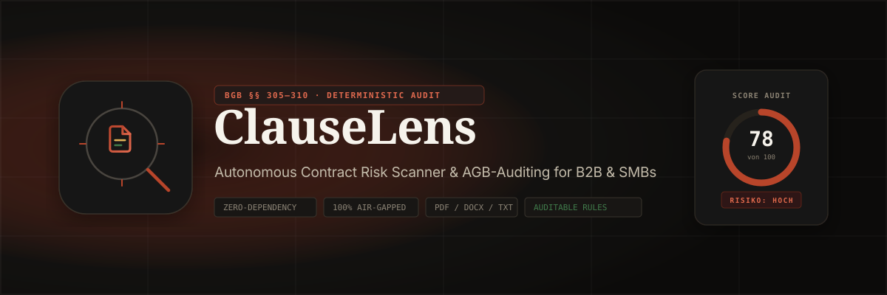

# ClauseLens



> **Autonome Vertragsanalyse & AGB-Auditierung für KMU und B2B.**  
> Findet versteckte Verlängerungsfallen, einseitige Haftungsausschlüsse und unzulässige Klauseln nach BGB §§ 305–310 — mit klartextlichen Gegenvorschlägen für die Nachverhandlung.  
> **Zero Dependencies · 100% Offline & DSGVO-konform · Node.js ≥ 18.**

---

## Highlights

- **Zero Runtime Dependencies:** Läuft direkt mit Node.js ≥ 18 ohne ein einziges npm-Modul (`node:fs`, `node:path`, `node:http`, `node:crypto`, `node:zlib`).
- **100% Air-Gapped & DSGVO-konform:** Verarbeitet Verträge lokal im Arbeitsspeicher; keine Datenübertragung an Cloud-LLMs oder externe Server.
- **Multiformat-Ingestion:** Eigene Pure-Node Parser für **PDF** (FlateDecode, WinAnsi/UTF-16BE, TJ-Kerning, Scan-Diagnose), **DOCX** (ZIP Central Directory + XML Entity Decoding) und **TXT**.
- **Präzise BGB-Regelmaschine:** 47 spezialisierte Klauseldetektoren (u.a. `auto_renewal`, `notice_period`, `liability`, `penalty`, `jurisdiction`, `non_compete`, `data_grant`, `default_interest`, `unilateral_change`, `deemed_acceptance`, `fictitious_receipt`, `service_suspension`, `asymmetric_termination`, `written_form_trap`, `unreasonable_audit`, `lock_in_data_export`, etc.).
- **Interaktiver HTML-Risikobericht:** Erzeugt selbstständige HTML-Audits mit SVG-Gauges, Filter-Pills, Sofort-Kopierfunktion für Redlines und Print-Stylesheet für PDF-Druck.
- **Versiegelter DIN-A4 Vektor-PDF-Bericht (`--pdf`):** Erzeugt mehrseitige, rechtssichere Audit-PDFs mit digitalem SHA-256 Integritätsstempel und exakten DIN-A4 Layouts – ohne Browser, ohne Headless Chrome, 100% nativ Node.js.
- **OASIS SARIF 2.1.0 Export (`--sarif`):** Standardisiertes Format für GitHub Code Scanning, GitLab Security, VS Code SARIF Viewer und CI/CD Security-Pipelines.
- **OpenAPI 3.0.3 & Developer Hub:** Vollständige API-Spezifikation unter `/api/v1/openapi.json` und interaktive Dokumentation unter `/docs`.
- **Branchenspezifische Prüfprofile:** Vorkonfigurierte Richtlinien für SaaS (`b2b_saas`), Freelancer (`freelance_consulting`) und Einkauf (`procurement_strict`), anpassbar über `clauselens.config.json`.
- **Portfolio- & Sammelaudit (`batch`):** Durchsucht ganze Vertragsbestände und ermittelt Portfolio-Risikoscores sowie Risiko-Hotspots.
- **Versionsvergleich (`compare`):** Vergleicht Erstfassung und Gegenentwurf nach Nachverhandlungen und berechnet das genaue Risikodelta.
- **Lokaler Server & REST-API (`serve`):** Integrierter HTTP-Server mit ClauseLens Studio Web-UI (Drag & Drop Datei-Upload, interaktive Redlines) und Programmierschnittstelle.
- **Erzwungene Account- & Seat-Lizenzierung:** Hardware-gebundene Seats mit 32-Zeichen Hardware-Fingerprint, online geprüft über Polar oder die Lizenz-API `https://license.kellersystems.dev` (Fallback `https://clauselens-license.papababg02.workers.dev`, wenn Cloudflare die Custom Domain blockt). Verträge bleiben 100% lokal im Speicher (kein Cloud-Transfer von Vertragsdaten).
- **Kommerzielles Lizenzmodell:** Polar bestellt, der Lizenzserver stellt einen `CL-` Schlüssel aus und mailt ihn; die CLI prüft den Schlüssel online und erhält ein 7 Tage gültiges, gerätegebundenes RS256-Sitzungstoken. Abgelaufene Sitzungen erneuern sich per `login`. Browser und GitHub Action nutzen denselben Lizenzserver; `index.html` und `studio.html` prüfen die Signatur des Sitzungstokens lokal per WebCrypto und vertrauen keinem `localStorage`-Eintrag allein.

---

> [!IMPORTANT]
> **Rechtlicher Hinweis / Disclaimer (§§ 1, 2 Rechtsdienstleistungsgesetz - RDG):**  
> ClauseLens ist ein automatisiertes, softwaregestütztes Prüf- und Audit-Werkzeug für die kaufmännische Vorprüfung und Risikoeinschätzung von Vertragstexten. Die generierten Analysen, Risikobewertungen und Formulierungsvorschläge stellen **keine Rechtsberatung** im Sinne des Rechtsdienstleistungsgesetzes (RDG) dar und ersetzen keinesfalls eine individuelle juristische Prüfung durch einen zugelassenen Rechtsanwalt oder Notar.

---

## Schnellstart

```bash
# 0. Einmalig: mit Lizenzschlüssel anmelden, Seat für diesen Rechner aktivieren
node bin/clauselens.js login --email kanzlei@recht.de --key CLA-PRO-...

# Testsuite ausführen (179 Tests, alle grün)
node --test

# Gehaltene Prüfverträge messen (Trefferquote, Fehlalarme, ungedeckte Fälle)
node test/holdout/runner.mjs

# Einzelvertrag analysieren und mehrseitigen PDF-Auditbericht sowie SARIF erzeugen
node bin/clauselens.js analyze vertrag.pdf --pdf audit.pdf --sarif results.sarif --html bericht.html

# Strukturierte JSON- und Markdown-Exporte
node bin/clauselens.js analyze vertrag.docx --json out.json --report report.md

# Ganzes Vertragsverzeichnis im Batch prüfen
node bin/clauselens.js batch ./vertraege --html portfolio.html

# Zwei Versionen vergleichen (Risikodelta nach Nachverhandlung)
node bin/clauselens.js compare v1.docx v2.docx --report delta.md

# Lokalen Webserver & ClauseLens Studio starten
node bin/clauselens.js serve --port 3000
```

---

## Benchmark & Ehrliche Leistungsbilanz (Corpus vs. Blind Real-AGB)

Jeder Befund (`finding`) enthält ein strukturiertes Normzitat (`citation`, z. B. `§ 309 Nr. 9 lit. b BGB, § 307 Abs. 1 BGB`). Wir weisen die Erkennungsleistung transparent getrennt nach Trainings-/Holdout-Korpus und **eingefrorener Engine auf ungesehenen Praxis-AGB** aus:

| Benchmark-Suite | Umfang | Fallen (Recall) | Kontrollklauseln (FP) | Befehl |
|---|---|---|---|---|
| **Red-Team-Korpus** (`Verträge/corpus` + `public`) | 410 Verträge | **3.058 / 3.058 (100,0 %)** | **0 / 2.811 (0,0 %)** | `node "Verträge/tools/score.mjs"` |
| **Out-of-Sample Holdout** (`test/holdout`) | 10 Verträge | **109 / 109 (100,0 %)** | **0 / 63 (0,0 %)** | `node test/holdout/runner.mjs` |
| **Blind Real-AGB Benchmark** (`Verträge/blind_real_agb`, *Frozen Engine*) | 25 deutsche Branchen-AGB | **107 / 198 Klausel-Treffer (54,0 %)** *(90 / 198 Typ-exakt, 45,5 %)* | **18 / 141 (12,8 %)** | `node "Verträge/blind_real_agb/runner.mjs"` |

- **Anwaltlicher Spot-Check (30 Befunde):** [`Verträge/reports/LAWYER_SPOT_CHECK_30.md`](Verträge/reports/LAWYER_SPOT_CHECK_30.md)
- **Blindtest-Analyse & Misses-Roadmap:** [`Verträge/reports/BLIND_REAL_AGB_ROADMAP.md`](Verträge/reports/BLIND_REAL_AGB_ROADMAP.md)
- **Einordnung (Public Beta / Audit Aid):** ClauseLens ist ein deterministischer Vorprüfungs-Assistent nach §§ 1, 2 RDG, **keine rechtliche Vollständigkeitsgarantie**. Die im Blindtest dokumentierten Misses und mehrsätzigen Haftungs-Carve-outs bilden die offene Engineering-Roadmap für v1.1.

---

## CLI-Befehle

| Befehl | Beschreibung |
|---|---|
| `login --email <m> --key <k>` | Prüft den Lizenzschlüssel beim Lizenzserver und speichert eine 7 Tage gültige Sitzung |
| `whoami` | Zeigt aktiven Account, Seat-ID und Hardware-Fingerprint |
| `logout` | Gibt den lokalen Geräte-Seat frei |
| `analyze <vertrag>` | Analysiert Einzelvertrag (`.pdf`, `.docx`, `.txt`) |
| `batch <ordner>` | Prüft Vertragsportfolio und aggregiert Risiken |
| `compare <v1> <v2>` | Vergleicht zwei Vertragsfassungen und berechnet Risikodelta |
| `serve [--port 3000]` | Startet lokalen Webserver (Landingpage, Studio, REST-API) |

Detaillierte Optionen und API-Dokumentation finden Sie in [`docs/USAGE.md`](docs/USAGE.md).

---

## Dokumentation

- [Whitepaper](docs/WHITEPAPER.md) — Regulatorischer Hintergrund (BGB §§ 305–310), deterministische Architektur und Benchmarks
- [Preismodell & Lizenzierung](docs/PRICING.md) — Commercial Tiers (Community, Pro, Enterprise), Unit Economics
- [Compliance & Datenschutz](docs/COMPLIANCE.md) — DSGVO Art. 28, RDG-Rechtsrahmen, Air-Gapped Garantie
- [Kommerzielle Strategie](docs/COMMERCIAL.md) — Go-to-Market, Zielgruppen und Positionierung
- [Architektur](docs/ARCHITECTURE.md) — Modulkarte, Datenfluss und Datenverträge
- [Klauseldetektoren](docs/DETECTORS.md) — Juristische Begründungen aller 47 Spezialdetektoren
- [Mitwirken](docs/CONTRIBUTING.md) — Richtlinien für Entwickler und neue Regelerweiterungen
- [Akquise-Mails](docs/OUTREACH.md) — Warum der Mailer ohne Rechtsgrundlage nicht sendet und wie Resend oder SMTP eingerichtet werden

---

## Lizenz

**Proprietary & Confidential (Closed Source)**  
Copyright © 2026 Keller Systems / ClauseLens. Alle Rechte vorbehalten.  
Nutzung ausschließlich im Rahmen einer gültigen kommerziellen Lizenzvereinbarung.
