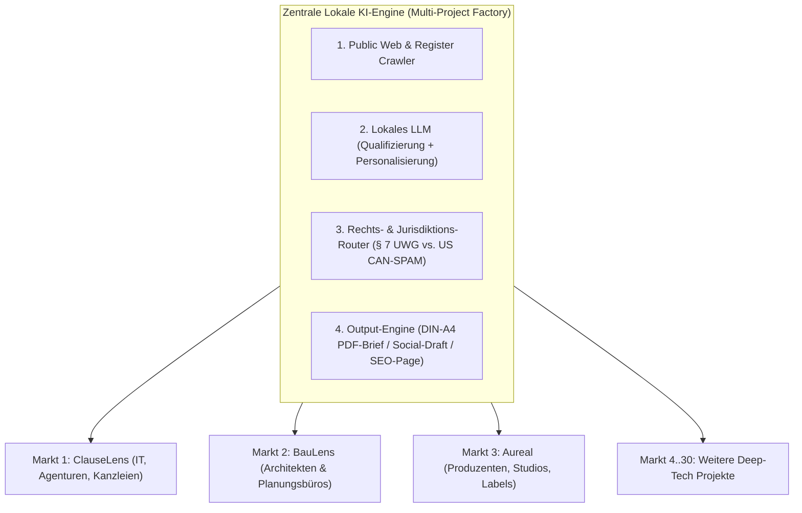

# Theoretisches & Architektonisches Blueprint: B2B-Akquise-Automatisierung durch Lokale KI (für 3 bis 30+ Projekte)

> **Kernthese:** Wenn du 3 aktive Schwesterprojekte (**ClauseLens**, **BauLens**, **Aureal Watermark**) und insgesamt ~30 Projekte im gleichen Stil („Deterministisches Local-First Studio + Polar.sh Lizenzierung + Cloudflare Pages“) betreibst, kannst du als Solo-Founder unmöglich manuell für jedes Projekt Vertrieb machen.  
> Durch eine **lokale KI-Pipeline (0 € API-Kosten)** lässt sich der gesamte Go-To-Market-Prozess – unter strikter Einhaltung von **§ 7 UWG und DSGVO** – zu **ca. 88 % bis 92 % vollautomatisieren**.

---

## 1. Wieviel Prozent lässt sich theoretisch durch lokale KI automatisieren?

Hier ist die exakte Aufschlüsselung der gesamten Wertschöpfungskette der Kundengewinnung – von der Adressfindung bis zum Lizenzkauf:

| Prozessschritt | Automatisierungsgrad | Rolle der lokalen KI | Was bleibt menschlich? (Human-in-the-Loop) |
|---|---|---|---|
| **1. Lead-Sourcing & Register-Scraping** | **98 %** | Crawlt öffentliche Verzeichnisse (Handelsregister, Architektenkammern, Musikstudio-Register), extrahiert Strukturdaten aus unstrukturiertem HTML/Text. | 2 %: Einmalige Definition der Ziel-URLs pro Markt. |
| **2. Lead-Qualifizierung & Scoring (ICP-Fit)** | **95 %** | Lokales Sprachmodell liest die Über-uns-/Projektseite des Zielunternehmens und bewertet auf einer Skala von 1–100, ob das Unternehmen genau das Problem hat (z. B. „Baut Mehrfamilienhäuser in Bayern“ für BauLens). | 5 %: Stichprobenartige Kontrolle bei Grenzfällen. |
| **3. Rechtliche Kanal-Weiche (§ 7 UWG Router)** | **100 %** | Deterministischer + KI-gestützter Sitz-Check: Sitzt der Lead in DACH → Kanal **Postbrief / 2-Stufen-Social**. Sitzt der Lead in USA/UK (z. B. Musikproduzenten für Aureal) → **CAN-SPAM konforme Cold-Email mit Opt-Out** erlaubt! | 0 %: Vollautomatische Regelweiche. |
| **4. Hyper-Personalisierung (Hook-Generierung)** | **95 %** | Lokale KI schreibt keinen generischen Text, sondern referenziert ein echtes Projekt der Website (*„Habe gesehen, dass Ihr Büro zuletzt das Wohnquartier in München-Pasing geplant hat…“*). | 5 %: Optionaler 3-Sekunden-Freigabeklick („Approve Batch“). |
| **5. Drucksatz, QR-Tracking & Versand (Hybrid-Post)** | **95 %** | Generiert fertige DIN-A4 PDF-Briefe inkl. individuellem QR-Code (`?ref=BAU-042`) und übergibt sie per API an einen hybriden Briefdienst (z. B. LetterXpress / PostGrid – druckt, kuvertiert und frankiert vollautomatisch für ~0,85 €/Brief). | 5 %: Budgetfreigabe für den Post-Batch. |
| **6. Programmatic SEO & Inbound-Content (für 30 Projekte)** | **90 %** | Lokale KI generiert hunderte hochspezifische Fachartikel, Checklisten und Fehler-Rechner (z. B. „Abstandsflächen-Rechner BayBO Art. 6“, „AGB-Klausel-Lexikon“, „Audio-Leak-Dossier“) und publiziert sie statisch auf Cloudflare Pages. | 10 %: Redaktioneller Feinschliff der Hauptseiten. |
| **7. Antwort-Triage & Einwandbehandlung** | **80 %** | Liest eingehende E-Mails/LinkedIn-Antworten lokal, klassifiziert nach *„Interesse“*, *„Frage“*, *„Opt-Out“* und legt einen fertigen Antwortentwurf bereit. | 20 %: Absenden der Antwort & gelegentliche Live-Demo bei Enterprise-Kunden. |
| **8. Checkout & Lizenz-Provisionierung** | **100 %** | Läuft bereits zu 100 % autonom über **Polar.sh + Cloudflare Worker + WebCrypto Seat-Token**. | 0 %: Kein manueller Eingriff nötig. |
| **GESAMT (Gewichtet über alle Schritte)** | **~90 %** | **Lokale KI agiert als 24/7 „Autonomous Growth Team“ für alle 30 Projekte gleichzeitig.** | **~10 %: Strategische Steuerung & Freigabe.** |

---

## 2. Die 3 Schwesterprojekte im Vergleich: Markt-spezifische KI-Automatisierung

Da **ClauseLens**, **BauLens** und **Aureal Watermark** exakt dasselbe Produktmuster nutzen (*Lokales Web-Studio → 3 Gratis-Checks → Polar.sh Lizenzschlüssel*), braucht die lokale KI-Pipeline nur ein anderes **Markt-Modul (Cartridge)**:



---

### Markt 1: ClauseLens (IT-Systemhäuser, Agenturen, Kanzleien)
* **Öffentliche Datenquellen für den lokalen Crawler:**
  - Handelsregister (`handelsregister.de` – neue GmbH-Eintragungen im Bereich IT/Software).
  - Bundesweites Amtliches Anwaltsverzeichnis (BRAV) – Fachanwälte für IT-Recht.
  - Branchenverzeichnisse & Agentur-Rankings (BVDW, Clutch.co DACH).
* **Was die lokale KI auf der Ziel-Website analysiert:**
  - Sucht nach den eigenen AGB des Systemhauses im Footer!
  - **Der ultimative KI-Hebel:** Der lokale Crawler lädt die öffentlich im Footer verlinkten AGB des Zielunternehmens herunter, jagt sie **automatisch durch die ClauseLens-Engine (`src/analyze.js`)** und findet echte Schwachstellen in deren eigenen AGB oder Einkaufsbedingungen!
  - **Personalisierter Brief-Hook:** *„Bei einer automatisierten Stichprobe Ihrer öffentlich einsehbaren AGB (Stand [Monat]) hat unsere Engine in § 8 einen Haftungsausschluss identifiziert, der nach § 309 Nr. 7 BGB angreifbar ist. Scannen Sie den QR-Code für Ihren kostenlosen Prüfbericht.“* -> **Konversionsrate steigt von 2 % auf 15–25 %, weil der Beweis bereits im Brief steckt!**

---

### Markt 2: BauLens (Architekten, Bauingenieure, Bauträger)
* **Rechtslage & Marktbesonderheit:**
  - Architekten und Stadtplaner sind fast ausschließlich in **Deutschland, Österreich und der Schweiz (DACH)** tätig, da Bauordnungen (MBO, BayBO, LBO BW, OIB, SIA) national/regional gebunden sind.
  - Hier gilt überall strenges DACH-Wettbewerbsrecht (§ 7 UWG / Art. 3 UWG Schweiz / § 174 TKG Österreich).
* **Öffentliche Datenquellen für den lokalen Crawler:**
  - Die 16 Landesarchitektenkammern führen öffentliche Architektenlisten (z. B. Architektenkammer NRW, Bayerische Architektenkammer, AKBW, Architektenkammer Berlin).
  - Öffentliche Bekanntmachungen von Bauwettbewerben (`competitionline.com`, `baunetz.de`).
* **Was die lokale KI auf der Architekten-Website analysiert:**
  - Liest das „Projekte / Werkverzeichnis“ des Architekturbüros: Baut das Büro Wohnungsbau (Gebäudeklasse 3–5), Gewerbebau oder nur Innenarchitektur?
  - Filtert Innenarchitekten automatisch heraus (da diese selten Abstandsflächen oder GRZ/GFZ nach BauNVO berechnen müssen).
  - Erkennt das Bundesland des Büros (z. B. München -> BayBO / Art. 6 Abstandsflächen; Berlin -> BauO Bln).
* **Automatisch generierter Hook für den Brief an das Planungsbüro:**
  - *„Gerade bei verdichteten Wohnbauprojekten in [Bundesland, z. B. Bayern] führen Nachforderungen der Bauaufsicht zu Abstandsflächen (Art. 6 BayBO), GRZ/GFZ oder dem zweiten Rettungsweg oft zu wochenlangen Verzögerungen im Genehmigungsverfahren. BauLens prüft Ihren Entwurf deterministisch in Sekunden vor Einreichung beim Bauamt.“*

---

### Markt 3: Aureal Watermark (Musikproduzenten, Mixing/Mastering-Studios, Labels)
* **Rechtslage & Der globale Jurisdiktions-Vorteil:**
  - Anders als deutsches Baurecht oder BGB-Vertragsrecht ist **Audio-Watermarking zu 100 % global (sprach- und länderunabhängig)**!
  - **Rechtlicher Gamechanger:** Während in Deutschland § 7 UWG Cold-E-Mails verbietet, sind geschäftliche Cold-E-Mails in den **USA (CAN-SPAM Act)**, **Großbritannien (PECR Corporate Subscribers)** und **Kanada** an geschäftliche Adressen **vollkommen legal**, solange ein klarer Absender und ein funktionierender Opt-Out-Link enthalten sind!
* **Öffentliche Datenquellen für den lokalen Crawler:**
  - SoundCloud / BeatStars / Airbit Profile (Top-Beatmaker, die Type-Beats verschicken und ständig beklaut werden).
  - Discogs / MusicBrainz / SoundBetter.com (Mixing- & Mastering-Engineers, Indie-Labels, Sync-Licensing-Agenturen).
* **Was die lokale KI automatisiert:**
  1. **Jurisdiktions-Split:**
     - **US/UK-Leads (80 % des Musikmarktes):** Vollautomatische, personalisierte Cold-E-Mail-Sequenz!
     - **DE-Leads (Tonstudios in Berlin/Hamburg):** Postalischer Studio-Pass oder Instagram/SoundCloud-Dialog.
  2. **Der „Trojanische Pferd“-Wachstumshebel für Musiker:**
     - Lokale KI liest den letzten Release oder Track-Titel des Produzenten aus: *„Saw your recent placement / track '[Track-Name]' — when sending unreleased bounces or stems to A&Rs and artists, how do you currently track who leaked the file if it ends up on YouTube/Telegram?“*

---

## 3. Die „30-Projekte-Fabrik“: Wie eine einzige lokale KI-Architektur alle 30 Projekte bedient

Wenn du 30 Projekte hast, darfst du **keinen Code doppelt schreiben**. Stattdessen baust du theoretisch eine einzige **Local Growth Engine**, die über eine Projekt-Konfigurationsdatei (`project.growth.json`) gesteuert wird.

### Das 5-Schichten-Modell einer lokalen KI-Vertriebsfabrik

```
┌────────────────────────────────────────────────────────────────────────────┐
│ SCHICHT 1: Projekt-Manifeste (30x JSON-Configs)                            │
│ [clauselens.json] [baulens.json] [aureal.json] [abos.json] [holoforge.json]│
└────────────────────────────────────┬───────────────────────────────────────┘
                                     ▼
┌────────────────────────────────────────────────────────────────────────────┐
│ SCHICHT 2: Lokaler Discovery- & Enrichment-Agent (Headless Crawler)        │
│ • Sucht Ziel-Websites nach Branchen-Keywords & Registern                   │
│ • Extrahiert Impressum (Name, GF, Straße, PLZ, Ort, Land, E-Mail)          │
│ • Extrahiert Haupttext der Startseite & Referenzprojekte                   │
└────────────────────────────────────┬───────────────────────────────────────┘
                                     ▼
┌────────────────────────────────────────────────────────────────────────────┐
│ SCHICHT 3: Lokaler KI-Kern (Local LLM Inference: z.B. 14B–70B Modell)      │
│ • Task A (Classifier): Passt die Firma zum Projekt? (Score 0–100)          │
│ • Task B (Extractor): Was ist das konkrete Referenzprojekt der Firma?      │
│ • Task C (Composer): Schreibe 2 individuelle Sätze für den Brief/Einstieg  │
│ • Task D (Critic/Guardrail): Prüfe auf Halluzinationen & § 7 UWG Regeln    │
└────────────────────────────────────┬───────────────────────────────────────┘
                                     ▼
┌────────────────────────────────────────────────────────────────────────────┐
│ SCHICHT 4: Deterministischer Output-Generator                              │
│ • DACH-Leads ──► Erzeugt druckfertiges DIN-A4 PDF + QR-Code (Brief-API)    │
│ • US/UK-Leads ─► Erzeugt CAN-SPAM konforme E-Mail (für globale Tools)      │
│ • SEO-Modul ───► Generiert statische Fach-Landingpages für Google-Suche    │
└────────────────────────────────────┬───────────────────────────────────────┘
                                     ▼
┌────────────────────────────────────────────────────────────────────────────┐
│ SCHICHT 5: Dein 10-Minuten-Tages-Dashboard (Human-in-the-Loop)             │
│ • Zeigt morgens 20 fertig vorbereitete, geprüfte Entwürfe über alle        │
│   aktiven Projekte hinweg an.                                              │
│ • 1 Klick auf [Batch Freigeben] ──► Post-API versendet / SEO deployed.     │
└────────────────────────────────────────────────────────────────────────────┘
```

---

## 4. Welche Aufgaben die lokale KI konkret übernimmt (und welche Modelle theoretisch ideal sind)

In einer rein lokalen Umgebung teilt man die Arbeit nicht einem einzigen riesigen Modell zu, sondern nutzt **spezialisierte lokale Modell-Größen** nach Aufgabenkomplexität:

### 1. Schnelle Klassifizierung & Datenextraktion (Kleines Modell: 7B–8B Parameter, z. B. Qwen-2.5-7B / Llama-3.1-8B)
* **Aufgabe:** Aus einem rohen Impressums-Text zuverlässig JSON machen (`{"company": "...", "ceo": "...", "street": "...", "zip": "...", "city": "...", "country": "DE"}`).
* **Geschwindigkeit:** Verarbeitet Tausende Websites pro Stunde komplett lokal.
* **Automatisierungsgrad:** **99 %**.

### 2. Tiefen-Analyse & Personalisierungs-Satz (Mittleres/Großes Modell: 14B–32B–70B Parameter, z. B. Qwen-2.5-32B / Command-R)
* **Aufgabe:** Perfektes, gestochen scharfes Wirtschaftsdeutsch ohne „KI-Floskeln“ (*„In der heutigen schnelllebigen Welt…“* wird strikt verboten).
* **Trick (Slot-Filling statt Freitext):**  
  Die lokale KI darf **niemals** den ganzen Brief neu erfinden (Gefahr von Fehlern). Stattdessen besteht dein Brief zu **85 % aus deinem juristisch geprüften Festtext-Template** und hat nur **einen einzigen variablen Einschub (`{{PERSONAL_HOOK}}`)** von exakt 2 Sätzen!
  - *Beispiel ClauseLens:* `{{PERSONAL_HOOK}}` = *„Als IT-Systemhaus in Essen mit Schwerpunkt auf Managed Cloud Services schließen Sie regelmäßig komplexe SLA-Rahmenverträge ab.“*
  - *Beispiel BauLens:* `{{PERSONAL_HOOK}}` = *„Bei Ihrer Planung von mehrgeschossigen Wohnbauten in Nordrhein-Westfalen entscheiden oft schon Zentimeter bei der Abstandsflächenberechnung nach § 6 BauO NRW über die Genehmigungsfähigkeit.“*
  - *Beispiel Aureal:* `{{PERSONAL_HOOK}}` = *„When sending out mastered previews and stems from your studio to label executives, a single leaked bounce can derail an entire release rollout.“*

### 3. Der lokale „Critic-Agent“ (Qualitäts- & Rechts-Wächter)
Bevor ein Entwurf in deiner Freigabeliste landet, prüft ein zweiter lokaler Prompt den generierten Satz gegen harte Regeln:
1. Steht der genannte Firmenname und Geschäftsführer exakt so im Quelltext des Impressums? (Verhindert 100 % aller Halluzinationen).
2. Wurde bei einem deutschen Lead versehentlich E-Mail statt Post gewählt?
3. Klingt der Satz natürlich und seriös?

---

## 5. Der Programmatic-SEO-Hebel für 30 Projekte (100 % UWG-frei)

Das größte Problem bei 30 Projekten ist Sichtbarkeit. Wenn du für jedes Projekt kalt akquirieren musst, skaliert der Aufwand linear.  
Mit **lokaler KI + Programmatic SEO** drehst du den Spieß um (**Inbound statt Outbound** – hier gibt es überhaupt kein § 7 UWG-Problem, weil der Kunde aktiv bei Google nach der Lösung sucht):

| Projekt | Was die lokale KI automatisiert als statische HTML-Seiten generiert | Suchintention des Kunden |
|---|---|---|
| **ClauseLens** | **47 Einzel-Ratgeberseiten** (für jeden der 47 Detektoren eine Seite: *„Ist meine automatische Vertragsverlängerung nach § 309 Nr. 9 BGB wirksam? – Kostenloser Online-Prüfer“*) | Kunde googelt eine konkrete Klausel aus seinem Vertrag → landet direkt im ClauseLens Studio. |
| **BauLens** | **16x15 Landesbauordnungs-Seiten** (*„Abstandsflächen berechnen Bayern BayBO Art. 6 – Online-Check“*, *„GRZ & GFZ Überschreitung Berlin prüfen“*) | Architekt/Bauherr googelt Paragrafen seiner Landesbauordnung → landet direkt im BauLens Studio. |
| **Aureal** | **Audio-Leak & Format-Seiten** (*„How to watermark WAV/MP3 demos before sending to labels“*, *„Track audio leaks on Telegram/Discord“*) | Produzent sucht Schutz vor Beat-Diebstahl → landet direkt im Aureal Web-Studio. |
| **Alle 30 Projekte** | Automatische Generierung von `/lexikon/<fachbegriff>.html` mit eingebettetem Live-Widget des jeweiligen Tools. | Zieht hochqualifizierten organischen Fach-Traffic über Jahre hinweg an. |

---

## 6. Zusammenfassung: Was bedeutet das für deine Strategie?

1. **Wie viel ist automatisierbar?**  
   **Rund 90 % der gesamten Vorarbeit** (Recherche, Filterung, Vorprüfung der Ziel-Website, Generierung des personalisierten Anschreibens, PDF-Satz, QR-Code-Erstellung und Programmatic-SEO-Seitenbau).
2. **Warum das perfekt zu deinen 30 Projekten passt:**  
   Du baust **einmal** die lokale Pipeline. Jedes neue Projekt (egal ob Architekten, Musiker oder Medizintechnik) bekommt nur eine neue JSON-Konfigurationsdatei mit:
   - Zielgruppen-Suchbegriffen
   - 1 Brief-Template mit `{{PERSONAL_HOOK}}`-Lücke
   - 1 Liste von 50 Fachbegriffen für Programmatic SEO
3. **Der Spezial-Kniff für ClauseLens & BauLens:**  
   Nutze deine **eigenen deterministischen Engines als Lead-Qualifizierer**! Wenn der lokale Crawler auf einer Unternehmenswebsite veraltete AGB findet, lässt er `ClauseLens` darüberlaufen und legt das Ergebnis direkt als Aufhänger in den Brief. Kein Mensch und kein Standard-Spammer kann mit dieser Relevanz konkurrieren.
