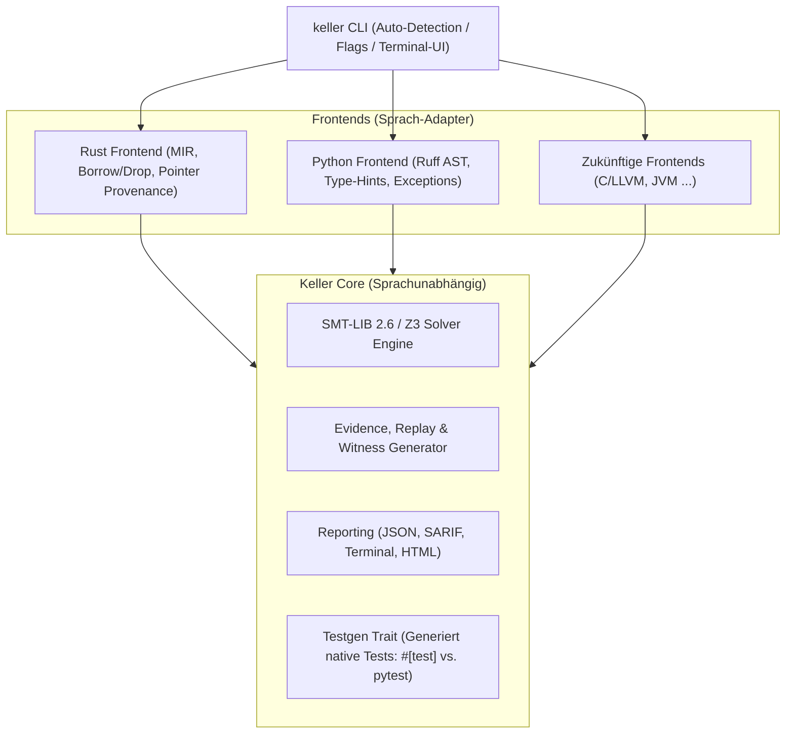

# Modularisierungs- und Multi-Language-Architektur für Keller-Verify

> **Status: Plan, nicht implementiert.**
> Dieses Dokument beschreibt eine geplante Architektur (Ruff-Parser, `keller verify --lang`, Feature-Layout `default = ["rust"]`). Der aktuelle Stand ist: Acht Sprach-Frontends existieren als feature-gated Heuristik-Scanner (`cargo build --features all-langs`, `keller-verify audit --lang <id> <pfad>`); sie senken nicht nach Keller-VIR, erzeugen keine SMT-Obligations und sind nicht Teil von `keller verify`. Verbindlich sind `docs/RELEASE.md` und der Audit in `DEV/AUDIT.md` (lokal, gitignored); die Frontends sind in `docs/LANGUAGES.md` beschrieben.

Dieses Dokument beschreibt die Architekturstrategie, um Keller-Verify modular für weitere Sprachen (insb. Python) zu öffnen, **ohne** die bestehende Rust-Kernfunktionalität zu beschneiden, zu verlangsamen oder durch übergroße Binaries aufzublähen.

---

## 1. Leitprinzipien

1. **Rust bleibt First-Class & kompromisslos stabil:**
   * Der bestehende MIR-Pipeline-Pfad (`after_analysis`, Path State, Pointer Provenance, Coroutines) bleibt funktional zu 100 % erhalten.
   * Keine erzwungenen Abstraktionen, die Rust verlangsamen oder Rust-spezifische Garantien verwässern.
2. **Kein monolithischer Bloat:**
   * Nicht alle Compiler, Parser und Runtimes werden zwingend in ein einziges Riesen-Binary kompiliert.
   * Modulare Feature-Gates und optionale Sub-Binaries verhindern 100+ MB Binaries und endlose Compile-Zeiten.
3. **Nahtlose User Experience (Zero-Config Auto-Detection):**
   * Keller erkennt das Projekt automatisch anhand der Manifeste (`Cargo.toml` vs. `pyproject.toml`).
   * Bei Ambiguität oder Mehrsprachigkeit entscheidet ein Flag (`--python`, `--lang python`) oder ein interaktiver Terminal-Prompt.

---

## 2. CLI- und Paketierungs-Architektur

### A. Intelligente Projekterkennung & Steuerung

Der Aufruf `keller verify` prüft die Umgebung in folgender Priorität:

```text
1. Explizites Flag:
   keller verify --python
   keller verify --lang python
   keller verify --rust

2. Automatische Erkennung via Manifeste:
   - Cargo.toml vorhanden? -> Starte Rust-Engine
   - pyproject.toml / requirements.txt / setup.py / *.py? -> Starte Python-Engine

3. Interaktiver Fallback (wenn beides oder keines eindeutig zutrifft):
   "Mehrere Projekttypen erkannt. Welche Sprache soll verifiziert werden?"
   [1] Rust (MIR via rustc)
   [2] Python (AST via ruff)
```

---

### B. Paketierungs-Modell: Feature Flags vs. Plugin-Binaries

Um die Binary-Größe und Abhängigkeiten schlank zu halten, wird ein zweistufiges Modell genutzt:

#### Stufe 1: Reines Rust-Ökosystem (Rust + Python via Feature Flags)
Sowohl der Rustc-Treiber als auch moderne Python-Parser (`ruff_python_parser`) sind in nativem Rust geschrieben und benötigen keine externen C/C++-Laufzeitbibliotheken (außer dem bereits vorhandenen Z3).

In `Cargo.toml`:
```toml
[features]
default = ["rust"]
rust = ["dep:rustc_driver_hooks"]
python = ["dep:ruff_python_parser", "dep:ruff_python_ast"]
all = ["rust", "python"]
```
* **Vorteil:** Ein einziges Binary (`keller-verify`) kann standardmäßig Rust und Python analysieren. Wer ein schlankes, reines Rust-Toolchain-Tool will, baut mit `--no-default-features --features rust`.

#### Stufe 2: Schwere / externe Runtimes (C/C++ via LLVM, Java/JVM, Go)
Sollten später Frameworks mit enormen nativen Abhängigkeiten hinzukommen (z. B. `llvm-sys` für C oder JVM-Konnektoren), wird das Subtool-Muster (wie bei `cargo` oder `git`) genutzt:
* `keller-verify` (Haupt-Binary mit Auto-Detection + Rust + Python).
* `keller-c` / `keller-jvm` als optionale Ergänzungs-Binaries.
* Fehlt das Binary für eine Sprache, gibt Keller eine klare Handlungsanweisung:
  ```text
  [Keller] Python-Unterstützung aktiv.
  [Keller] C-Engine ist nicht installiert. Installiere sie mit:
           cargo install keller-c
  ```

---

## 3. Modulare Code-Architektur

Die Codebasis wird in 3 saubere Schichten unterteilt:



### 1. `keller-core` (Sprachneutral)
* **Z3 & SMT-LIB:** Verwaltung der Solver-Instanzen, Bitvektor- und Integer-Formeln, `check-sat`, Model-Extraktion.
* **Evidence & Obligationen:** Generierung von `.witness.smt2`, `index.json`, Replay-Mechanismus (`keller replay`).
* **Reporting:** SARIF v2.1.0, JSON-Summary, Exit-Code-Konventionen (0 = PASS, 1 = FAIL, 3 = Setup-Error).

### 2. `keller-frontend-rust` (Bestehende Engine)
* Bleibt 100% optimiert für MIR.
* Behandelt `AssertKind::BoundsCheck`, `Overflow`, `DivisionByZero`, `ResumedAfterDrop`, `NonNull`.
* Generiert `#[test] #[should_panic]`-Tests via `keller testgen`.

### 3. `keller-frontend-python` (Neues Modul)
* Nutzt den extrem schnellen `ruff_python_parser` (aus dem Astral/Ruff-Projekt).
* Übersetzt Funktionen mit Typannotationen in symbolische Pfade.
* **Typische Python-Fehlerklassen:**
  * `ZeroDivisionError` (z. B. `x / y` oder `x % y` wenn `y == 0`).
  * `IndexError` (Listen-/Tuple-Zugriff `lst[idx]` außerhalb von `0 <= idx < len(lst)`).
  * `KeyError` (Zugriff auf Dictionaries ohne Vorabprüfung).
  * `AttributeError: 'NoneType'` (Dereferenzierung von Optional-Werten `x.foo` wenn `x is None`).
  * `Uncaught Exception` (explizite `raise`-Pfade).
* **Testgen-Ziel:** Generiert sofort ausführbare `pytest`-Funktionen:
  ```python
  import pytest
  from my_server import handle_request

  def test_keller_witness_handle_request():
      with pytest.raises(ZeroDivisionError):
          handle_request(worker_count=0)
  ```

---

## 4. Rollout-Plan

1. **Phase 1: Vorbereitung & Abstraktion von Core-Diensten**
   * Gemeinsame Schnittstellen für Solver, Reporting und Replay festigen, ohne die Rust-MIR-Pfade zu stören.
2. **Phase 2: CLI-Erweiterung (`--lang` / `--python`)**
   * Manifest-Detection (`Cargo.toml` vs. `pyproject.toml`) im CLI-Dispatcher implementieren.
3. **Phase 3: Python-Prototyp (`keller-frontend-python`)**
   * Minimales Frontend auf Ruff-Basis für grundlegende arithmetische Guards und Division/Modulo durch Null.
   * Testgen-Emitter für `pytest`.
4. **Phase 4: Golden- & Integrationstests**
   * Eigener Test-Korpus für Python-Fixtures (`tests-py/`), während alle bestehenden Rust-Goldens unverändert und grün bleiben.
