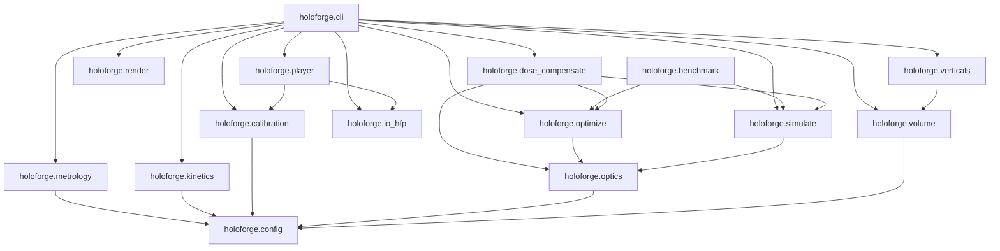
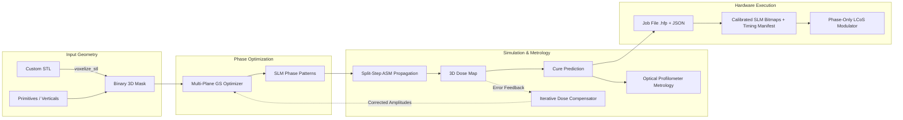

# HoloForge System Architecture

This document describes the software and hardware-control architecture of the HoloForge holographic volumetric 3D printing platform.

---

## 1. Module Dependency Graph

---

## 2. End-to-End Data Flow Pipeline

From 3D digital CAD model to real-time holographic hardware exposure:

---

## 3. Core Functional Layers

### Layer 1: Configuration & Physics Core (`config.py`, `optics.py`)
- `OpticsConfig`: Defines laser wavelength, SLM pixel count ($N$), pixel pitch ($p_{\text{SLM}}$), relay demagnification ($M$), and resin refractive index ($n_{\text{vat}}$).
- `GridConfig`: Defines the 3D computational discretization ($N_x \times N_y \times N_z$) and axial step size ($\Delta z$).
- `ResinModel`: Physical and photochemical parameters ($D_{\text{gel}}$, absorption $\alpha$, scatter mean free path $L_{\text{scatter}}$, refractive index).
- `VatPropagator`: High-performance batched split-step angular spectrum propagator computing forward walks and adjoint backward walks.

### Layer 2: Inverse Solvers & Compensation (`optimize.py`, `dose_compensate.py`)
- `MultiPlaneGS`: Band-decomposed Gerchberg-Saxton algorithm using scale-free least-squares amplitude projections and guard slice out-of-band suppression.
- `DoseCompensator`: Outer feedback loop updating per-voxel target amplitudes to pre-compensate for depth-dependent Beer-Lambert attenuation and forward scattering.

### Layer 3: Photochemical Kinetics & Metrology (`kinetics.py`, `metrology.py`)
- `simulate_kinetics`: Solves coupled differential equations for dissolved oxygen depletion ($[O_2](t)$) and radical photopolymerization conversion ($\chi(t)$) in PEGDA and HDDA.
- `calculate_roughness`: Extracts topography height maps and computes ISO 4287 roughness parameters ($R_a, R_q, R_z$) to verify the $<100\text{ nm}$ optical surface finish.
- `analyze_channel_patency`: Assesses internal microfluidic void clearance and hydraulic diameter.

### Layer 4: Commercial B2B Verticals (`verticals.py`, `volume.py`)
- Generates parametric CAD primitives for digital dental crowns, monolithic microfluidic chips with serpentine channels, and precision even-asphere lenses.
- Ray-parity STL voxelizer and binary/ASCII STL exporter.

### Layer 5: Hardware Driver & Pattern Player (`calibration.py`, `player.py`, `io_hfp.py`)
- `SLMCalibrationLUT`: Phase response Look-Up Table calibration ($[0, 255] \leftrightarrow [0, 2\pi]$) and flat-field beam profile correction.
- `prepare_hardware_bundle`: Generates calibrated 8-bit bitmaps and JSON exposure timing manifests ($t_k = T_{\text{total}} \cdot w_k$).
- `.hfp` container format (compressed NPZ payload + metadata JSON sidecar).
