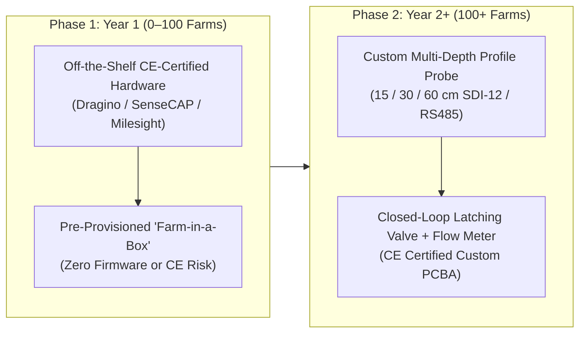

# Commercial Hardware & Productization Guide (`HARDWARE.md`)

> **Purpose:** This document is the realistic engineering and commercialization roadmap for turning this repository from a software prototype + DIY reference BOM into a **deployable, legally compliant, profitable European AgriTech hardware-enabled SaaS product**.
> *(For the existing DIY prototype wiring diagram, see [docs/HARDWARE_GUIDE.md](docs/HARDWARE_GUIDE.md)).*

---

## 1. The Reality Check: Why Not Build Custom Hardware in Year 1?

The current repository outlines a **€55 custom BOM / €89 retail kit** built around a bare Seeed Wio-E5 module, a €16.50 RS485 capacitive probe, a TP5000 charger board, and a hand-drilled ABS box.

While that works for 3 bench prototypes, **shipping custom hardware to paying farmers in Year 1 will stall your business** for four reasons:

1. **EU Radio & Environmental Certification Costs (€8,000–€18,000 upfront):**
   - Any custom PCB transmitting on 868 MHz sold commercially in the EU requires **RED (Radio Equipment Directive 2014/53/EU)** testing (ETSI EN 300 220-2), EMC emissions testing (EN 301 489-1/-3), electrical safety (EN 62368-1), RoHS compliance, **WEEE** registration (*Stiftung EAR* in Germany), and **BattG** battery registration.
2. **Cheap Capacitive Probes Drift in Fertilized Soils:**
   - €15–€20 generic probes operate at low excitation frequencies (10–30 MHz). When a grower runs **fertigation** (injecting nitrate/potassium into the drip line), soil Electrical Conductivity (EC) spikes and causes cheap capacitive probes to falsely report a +10% to +25% VWC jump. High-accuracy agricultural probes must excite at **70–150 MHz (FDR / TDR)** and measure permittivity, temperature, and bulk EC simultaneously.
3. **Single-Depth Probes Miss the Drip Wetting Bulb:**
   - Under drip irrigation, water forms an onion-shaped plume beneath the emitter. A single-point horizontal prong at 40 cm tells you nothing about whether water is pooling at 15 cm (evaporating) or draining past 60 cm (leaching nitrates below the roots).
4. **The "Missing Gateway" Problem:**
   - Vineyards and orchards sit in rural valleys where public **The Things Network (TTN)** coverage is non-existent. A probe without a gateway is a brick.

---

## 2. Two-Stage Hardware Strategy (COTS Now $\rightarrow$ Custom Later)

### Phase 1 (Months 1–12): The "Zero-R&D" Pre-Paired Commercial Starter Kit
Instead of soldering PCBs, buy **CE/RED-certified industrial LoRaWAN hardware** wholesale, pre-register the DevEUIs and SIM card in your backend before shipping, and sell a turnkey **"Plug-and-Play Vineyard Starter Kit"**.

#### Recommended Phase 1 Commercial Bill of Materials (3-Zone Farm Kit)

| Role | Commercial Hardware Model | Key Specs | Wholesale Cost (Ex-VAT) |
| :--- | :--- | :--- | :---: |
| **LoRaWAN Soil Probe (×3)** | **SenseCAP S2105** or **Dragino LSE01** | Volumetric Water Content (FDR), Soil Temp, Bulk EC ($\mu\text{S/cm}$), IP66/IP68, built-in Li-SOCl₂ battery (5–8 yr life, no solar panel needed) | €65 × 3 = **€195** |
| **Field Gateway (×1)** | **Milesight UG65** (IP65) or **Dragino LPS8v2 + Outdoor Enclosure** | 8-channel SX1302 LoRaWAN gateway, integrated 4G/LTE cellular modem, PoE / 12V solar input | **€185** |
| **IoT Cellular SIM (×1)** | **1NCE IoT Flatrate SIM** | 500 MB + SMS across all EU networks for **10 years** (multi-carrier roaming: Telekom, Vodafone, O2, A1) | **€10** *(for 10 years!)* |
| **Valve Controller (Optional)** | **Milesight UC511 / UC512** or **Dragino LT-22222** | Solar/battery LoRaWAN Class A/C controller with two **9V/12V DC latching solenoid outputs** + 2 pulse water meter inputs | **€115** |
| **Mechanical Armor** | **HDPE Braided Conduit + Stainless Ground Staples** | Protects sensor cable from mechanical under-vine weeders (*Stockräumer*), rabbits, and trimmers | **€15** |
| **Total Kit Landed Cost** | **3 Probes + 4G Gateway + 10yr SIM (+ Valve Node)** | **100% CE/RED Certified, Ready to Ship Tomorrow** | **€405** *(€520 with valve control)* |

- **Recommended Retail Price (Starter Kit):** **€690 – €890** upfront + **€249/year** software & WhatsApp compliance subscription.
- **Why Li-SOCl₂ Primary Batteries Beat Solar in Phase 1:** A 19Ah Lithium-Thionyl Chloride ($\text{Li-SOCl}_2$) battery inside a Dragino LSE01 or SenseCAP S2105 lasts **5 to 8 years** at 30-minute uplinks without any solar panel. In a vineyard, vine shoots grow over trellis posts in June, shading tiny solar panels and killing small LiFePO4 cells right when irrigation season starts, or copper/sulfur fungicide sprays coat the solar glass.

---

## 3. Phase 2 (Months 12+): Custom Multi-Depth Hardware Specification

Once you have 50–100 paying farms and want to build the proprietary **TerraFlux / FieldSense** hardware shown on your landing page, here is what the real engineering specification must look like.

### 3.1 Multi-Depth Tubular Profile Probe (15 cm / 30 cm / 60 cm)
To match the landing page claim (*"Capacitance at three depths: 15, 30 and 60 cm"*), do not bury three separate wired prongs (which requires digging a 60 cm trench and disturbs soil bulk density).
- **Form Factor:** A single **28 mm diameter polycarbonate/fiberglass access tube** hammered into a pre-augered vertical hole, containing **three internal cylindrical ring-capacitor sensors** spaced at **15 cm, 30 cm, and 60 cm** below the collar.
- **Agronomic Value of 3 Depths:**
  1. **15 cm (Surface Horizon):** Detects light rain events (<5 mm) and surface evaporation; tells the controller when drip water begins infiltrating.
  2. **30 cm (Primary Feeder Root Zone):** Main trigger for irrigation start ($D_r > \text{RAW}$).
  3. **60 cm (Deep Root / Drainage Boundary):** Detects **over-irrigation and deep percolation**. Whenever the 60 cm sensor spikes after an irrigation cycle, the controller knows the valve ran too long and automatically shortens the next cycle by 15%.

### 3.2 Closed-Loop Valve Actuation & Flow Verification (The Missing Link)
An irrigation system that either *only sends a message* or *blindly opens a solenoid valve* is dangerous in agriculture:
- If a solenoid valve sticks open, or a wild boar bites through a polyethylene drip lateral, a blind timer will pump $100\text{ m}^3$ of water down a hillside, causing erosion and emptying the reservoir.
- **Required Hardware Loop on the Valve Node:**
  1. **9V DC Latching Solenoid Driver (H-Bridge + Capacitor Bank):** Standard irrigation valves in fields without AC power use **9V DC latching solenoids** (requires a 25–50 ms pulse of $+9\text{V}$ to open and $-9\text{V}$ to close; draws $0\text{ mA}$ while holding open). Charge a $4700\text{ }\mu\text{F}$ electrolytic capacitor bank to $12\text{V}$ via a boost converter before firing the H-bridge.
  2. **Pulse Water Meter Input (Reed Switch / Hall Effect):** Connect a standard DN25/DN40 inline pulse water meter ($1\text{ pulse} = 10\text{ L}$ or $100\text{ L}$) to an ultra-low-power hardware counter (`LPTIM` on STM32WLE5, which counts pulses even while the MCU is in Stop 2 deep sleep).
  3. **Hardware Safety Watchdog:** The node firmware must store the **target volume (liters) and maximum runtime (minutes)** locally in non-volatile FRAM/EEPROM at the moment the valve opens. Even if the LoRaWAN gateway or internet goes down mid-cycle, the MCU autonomously closes the latching solenoid the instant the target pulse count or timeout is reached.
  4. **Leak & Blockage Detection Alerts via WhatsApp:**
     - *Valve commanded OPEN, but 0 pulses after 5 minutes* $\rightarrow$ WhatsApp Alert: `🚨 PUMP / FILTER FAULT: Valve V4 opened at 05:30, but zero water flow detected.`
     - *Valve commanded CLOSED, but pulses continue* $\rightarrow$ WhatsApp Alert: `🚨 STUCK VALVE / LEAK: Flow detected on Zone B2 while valve is closed!`

### 3.3 Custom PCB Electrical Corrections (Fixing `docs/HARDWARE_GUIDE.md` & `docs/FIRMWARE_SPEC.md`)
If you build the custom Wio-E5 node described in [docs/HARDWARE_GUIDE.md](docs/HARDWARE_GUIDE.md), fix these electrical flaws in the current spec:
1. **5V/12V Boost Rail for Industrial RS485 Probes:**
   - [docs/HARDWARE_GUIDE.md](docs/HARDWARE_GUIDE.md) shows powering the `RS-WS-N01-TR` probe from `Switched 3.3V`. Most industrial RS485 soil probes (`RS-WS-N01-TR`, Renke, JXBS-3001) require **5V–24V DC excitation** and brown out at 3.3V. Add a switched 5V or 12V synchronous boost converter (`TPS61023` or `MT3608`) gated by the high-side load switch.
2. **RS485 Transceiver Chip (`MAX3485` / `SP3485`):**
   - [docs/HARDWARE_GUIDE.md](docs/HARDWARE_GUIDE.md) wires `PA2` and `PA3` directly to RS485 `A+` and `B-`. STM32 UART pins are 3.3V TTL (`RX`/`TX`), not differential RS485! You must include an auto-direction **3.3V RS485 transceiver IC (`MAX13487E` or `SP3485`)** with $\pm 15\text{ kV}$ ESD protection (`SM712` TVS diode array) on the `A`/`B` lines, because lightning strikes near long vineyard trellis wires induce lethal voltage surges on buried sensor cables.
3. **Cold-Weather LiFePO4 Charging Protection:**
   - Standard `TP5000` charger ICs will attempt to charge a LiFePO4 cell at $-5^\circ\text{C}$ on a sunny January morning, permanently plating metallic lithium onto the anode. Use a charger IC with an **NTC thermistor pin** (e.g., `BQ25185` or `CN3791` with NTC cutoff at $0^\circ\text{C}$).
4. **LoRaWAN Duty Cycle & ADR Compliance:**
   - [docs/FIRMWARE_SPEC.md](docs/FIRMWARE_SPEC.md) hardcodes `SF7` and random frequency selection. In production EU868, you must enable **Adaptive Data Rate (ADR)** in a certified LoRaWAN 1.0.3/1.0.4 stack (`LoRaMac-node` or `RadioLib` LoRaWAN manager) and respect the **1% ETSI duty cycle limit** (`36 seconds/hour` max airtime on g1 sub-band).

---

## 4. Field Installation Checklist for Agricultural Durability

1. **Cable Armor Against Vineyard Machinery:**
   - Never leave exposed PVC cable between the soil surface and the trellis post. Route the sensor cable inside **UV-stabilized corrugated PA6/HDPE conduit** secured to the *inside* (leeward side) of the metal or wooden trellis post so mechanical under-vine cultivators (*Stockräumer*) cannot snag it.
2. **Slurry Coat for Zero Air-Pocket Contact:**
   - In stony vineyard soils (Kaiserstuhl volcanic tephra, Wachau gneiss/loess), pushing metal prongs into undisturbed stony soil bends the prongs or leaves millimeter air gaps alongside stones (which causes a $-50\%$ VWC reading error because $\epsilon_{\text{air}} = 1$).
   - **Standard Operating Procedure:** Auger hole $\rightarrow$ screen out stones $>5\text{ mm}$ from excavated soil $\rightarrow$ mix a thick **soil-water slurry** from the native fine earth $\rightarrow$ coat the probe/tube in slurry during insertion so it cures with 100% hydraulic continuity with the surrounding soil matrix.
3. **Placement Relative to Drip Emitter:**
   - Install the probe consistently **10–15 cm laterally away from a drip emitter** (along the row, in the wetting zone) and **never directly between two emitters** (50 cm apart) where early-season drip bulbs don't overlap.
