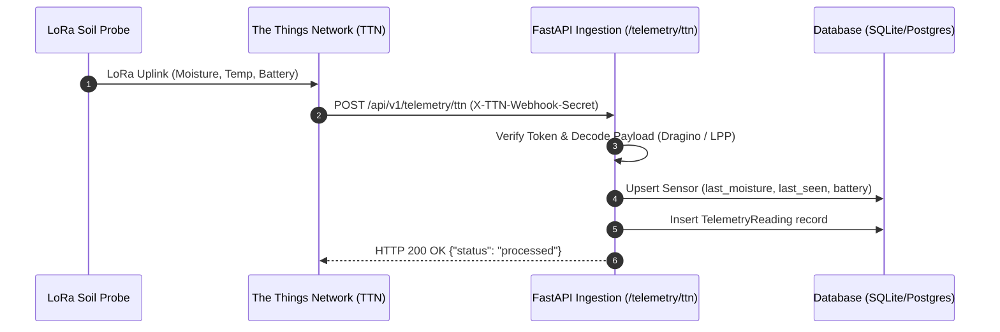
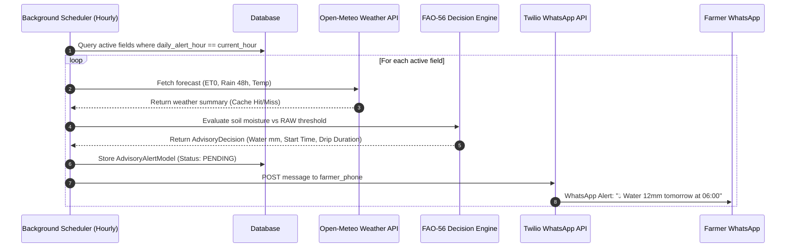
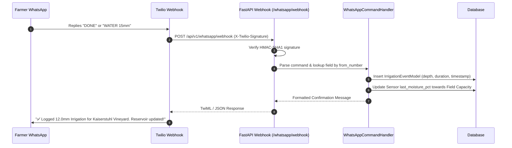
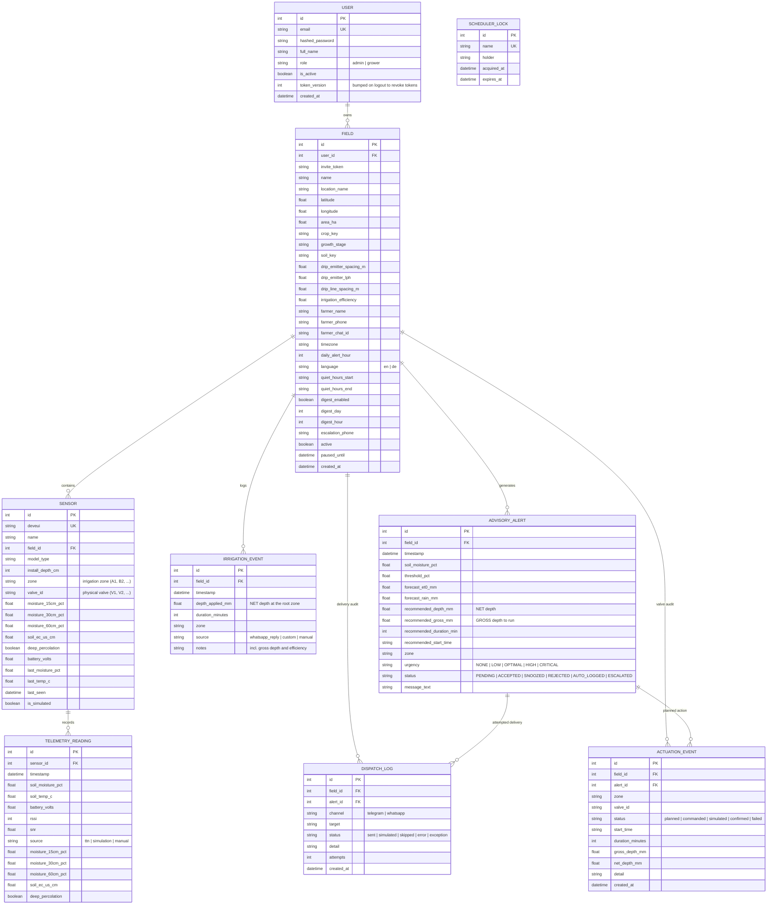

# TerraFlux (FieldSense Engine) — System Architecture & Technical Specification

## 1. System Overview

TerraFlux is an autonomous IoT agronomy platform designed to calculate real-time soil
water depletion and deliver daily actionable recommendations via Telegram (primary
channel, zero Meta fees) and WhatsApp (fallback), without requiring farmers to log
into a dashboard. Every block, probe, advisory, delivery attempt and valve command is
recorded, so the operator can see what was advised, what was delivered and what was
actually applied.

---

## 2. Component Topology

```
+--------------------------------------------------------------------------------------------------+
|                                    Physical Layer / Edge IoT                                     |
|  [Soil Moisture & Temp Probe (RS485/ADC)] ---> [LoRaWAN Node (EU868)] ---> [LoRaWAN Gateway]     |
+--------------------------------------------------------------------------------------------------+
                                                   |
                                            (HTTP Webhook)
                                                   |
+--------------------------------------------------v-----------------------------------------------+
| TerraFlux Cloud Application (FastAPI + SQLModel)                                                |
|                                                                                                  |
|  +--------------------------------------------------------------------------------------------+  |
|  |  Security & Ingestion Layer                                                                |  |
|  |  - Request-ID & Structured Logging Middleware                                              |  |
|  |  - TTN Secret Token Ingestion: POST /api/v1/telemetry/ttn                                 |  |
|  |  - Twilio HMAC-SHA1 Webhook Ingestion: POST /api/v1/whatsapp/webhook                      |  |
|  |  - Weather Ingestion with 4h TTL Cache (Open-Meteo Agro Client)                            |  |
|  +--------------------------------------------------------------------------------------------+  |
|                                                |                                                 |
|  +---------------------------------------------v----------------------------------------------+  |
|  |  Agronomic Decision & Physics Engine                                                       |  |
|  |  - FAO-56 Penman-Monteith Reference ET0 & Crop Etc (Kc Stages)                            |  |
|  |  - Soil Water Reservoir Model (TAW, RAW, Depletion Dr, Critical Threshold)                 |  |
|  |  - 48h Rain Forecast Suppression & Irrigation Run-Time Calculator                          |  |
|  +--------------------------------------------------------------------------------------------+  |
|                                                |                                                 |
|  +---------------------------------------------v----------------------------------------------+  |
|  |  Automation & User Channel                                                                 |  |
|  |  - Asynchronous Background Scheduler (Daily 19:00 UTC hourly dispatcher)                   |  |
|  |  - WhatsApp Message Formatter & Two-Way Interactive Command State Machine                   |  |
|  |  - Twilio WhatsApp Client (Dispatches alerts to farmer mobile)                            |  |
|  +--------------------------------------------------------------------------------------------+  |
|                                                |                                                 |
|  +---------------------------------------------v----------------------------------------------+  |
|  |  Data Persistence & Storage Layer                                                          |  |
|  |  - SQLite (WAL mode, busy timeout 5s) / PostgreSQL Connection Pool                         |  |
|  |  - Tables: fields, sensors, telemetry_readings, irrigation_events, advisory_alerts          |  |
|  +--------------------------------------------------------------------------------------------+  |
+--------------------------------------------------------------------------------------------------+
```

---

## 3. Sequence Workflows

### 3.1 LoRaWAN Telemetry Ingestion Flow


### 3.2 Daily Advisory Background Evaluation & WhatsApp Dispatch (19:00 UTC)


### 3.3 Farmer Two-Way Reply Flow


---

## 4. Entity-Relationship Data Model



**Depth convention:** `AdvisoryAlertModel.recommended_depth_mm` and
`IrrigationEventModel.depth_applied_mm` hold the **net** depth (water that reached the
root zone). `recommended_gross_mm` holds the **gross** depth the grower has to run
(``net ÷ irrigation efficiency``). Run time is ``net depth ÷ net application rate``.

**Provenance:** `TelemetryReadingModel.source` separates physical uplinks (`ttn`) from
fast-forward simulation output (`simulation`), so analytics never mix the two.

---

## 5. Security Architecture

1. **Authentication & Ingestion Authorization:**
   - Bearer tokens (HMAC-SHA256 signed, 72 h expiry) with a per-user `token_version`;
     bumping the version revokes every previously issued token (`POST /api/v1/auth/logout`).
   - Passwords are hashed with PBKDF2-HMAC-SHA256 (120 000 iterations, per-user salt).
   - Pre-shared secret validation (`X-TTN-Webhook-Secret`) on IoT endpoints.
   - Cryptographic HMAC-SHA1 validation on Twilio webhook endpoints.
   - Secret-token validation (`X-Telegram-Bot-Api-Secret-Token`) on the Telegram webhook.
   - Immediate rejection of unregistered phone numbers with zero cross-tenant contamination.
2. **Tenant Isolation:**
   - Every field-scoped endpoint requires a token and checks ownership (`require_field_access`).
   - Growers only ever see their own blocks; administrators see all.
   - Contact data and Telegram invite tokens are only disclosed to the owner (or an admin).
   - Public registration can never create an administrator; role changes require an admin token.
3. **Rate Limiting & Lockout:**
   - Per-IP and per-account limits on login/registration, per-user limits on the API and
     per-IP limits on the webhooks (`src/core/rate_limit.py`).
   - Repeated failed logins lock the account for `LOGIN_LOCK_SECONDS`.
4. **Data Sanitization & Injection Prevention:**
   - Parameterized SQL execution through SQLModel/SQLAlchemy ORM.
   - HTML entity escaping across web templates.
5. **Security Headers:**
   - `X-Content-Type-Options: nosniff`
   - `X-Frame-Options: SAMEORIGIN`
   - `Referrer-Policy: strict-origin-when-cross-origin`

---

## 6. Schema Migrations

The schema is managed with **Alembic** (`migrations/`, `alembic.ini`):

```bash
alembic upgrade head                       # apply migrations
alembic revision --autogenerate -m "..."   # new revision after a model change
alembic check                              # detect model/migration drift (CI gate)
```

The Docker image applies `alembic upgrade head` before starting the API. The service
additionally performs backwards-compatible column backfills on startup, so an older
SQLite file keeps working without a manual migration.

